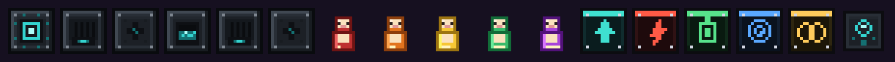
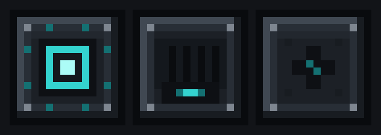
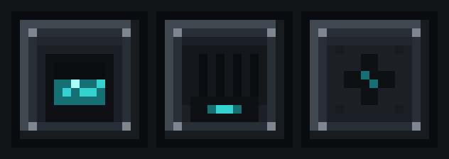

# Voidgen · 虚无发电机 + 虚无熔炉 + 虚无值系统 + AE2 虚无磁盘 / 虚空合成器

**Minecraft 1.21.1 · NeoForge 21.1.x · v2.6.0 · 单文件 mod jar（249.9 KB）**

凭空发电 + 套娃升级 + AE2 风格内部 GUI + 无线供电 + 升级卡系统 + 跨维度自动无线供电 + 凭空熔炼的虚空熔炉 + 面配置器 + 熔炉 AE 回传 + AE2 线缆直连（网格节点）+ **虚无值系统**（存储器 / 收集装置 / 发散器 / 虚无生物生成器）。不装 AE2 也能玩；装了 AE2（19.x）会作为附属联动。








>
## 文件

- **模组**：[dist/voidgen-2.6.0.jar](dist/voidgen-2.6.0.jar) — 丢进 `.minecraft/mods/` 即可
- **贴图预览**：[docs/preview.png](docs/preview.png) · 发电机近拍：[docs/zoom.png](docs/zoom.png) · 熔炉近拍：[docs/zoom_furnace.png](docs/zoom_furnace.png) · 卡面近拍：[docs/zoom_cards.png](docs/zoom_cards.png)
- 源码：[src/main/java/com/voidgen](src/main/java/com/voidgen)
- 构建/校验脚本：[tools/](tools/)

## 安装

1. Minecraft **1.21.1** + **NeoForge 21.1.x**（Java 21）
2. 把 `voidgen-2.6.0.jar` 放进 `mods/`
3. 可选：加装 **AE2 19.x** 以获得完整联动（线缆直连、能量接收器直连、AE2 加速卡/容量卡兼容、熔炉 AE 回传）

## 游戏内说明（G 键）

- 进游戏后按 **G** 打开「Voidgen 使用说明」窗口：滚轮 / ↑ ↓ / PageUp PageDown 滚动，Esc 或再按 G 关闭。
- 窗口内分节列出：虚无发电机、虚无值系统、虚无熔炉、AE2 联动（磁盘 / ME 供应器 / 虚空合成器）、常用按键。
- 按键可以在「选项 → 控制 → Voidgen」里改。

## 玩法

### 虚空发电机

- 放下即凭空产电，自动向 6 个相邻方块输出，同时进行无线供电。
- 基础 **1,000 FE/t**；每阶套娃 ×4，V 阶 1,024,000 FE/t。
- 储能 = 1,000,000 × 4^阶数 × 2^容量卡数，上限 **92,000,000,000**。
- 发电/传电速率上限 **920,000,000 FE/t（9.2E）**，卡叠满后封顶。
- 空手右击：动作栏显示阶数、发电、储能、无线范围；绑定数量与自动连接状态显示在背包饰品槽的覆盖层上。

### 内部 GUI（右击方块）

- 发电机：AE2 风格深色面板，顶部渐变能量条、4×3 = 12 个升级卡槽、单个 **AE 输出** 开关、能量/范围/阶数信息。
- 熔炉：左侧 3×3 输入、右侧 3×3 输出（槽位上限 8192 起）、12 个升级卡槽、速率/单槽信息、底部 **无线输出** 与 **AE 回传** 两个开关。
- 发电机：**Shift + 右击** 打开面板；熔炉：**直接右击** 打开面板。
- 手持升级卡/套娃 **Shift+右击熔炉** 可在外部直接安装（不用开面板）；Shift + 点击物品在背包与卡槽间快速移动。

### 无线供电与自动连接

- 发电机每 tick 自动向**范围内**所有玩家放置的、能接收 FE 的机器供电，不需要线缆或绑定卡。
- 接收器列表会在**区块加载时自动重建**：旧存档里的机器、被强加载的跨维度机器都会被重新发现，不需要玩家重新放置。
- **跨维度**：只要目标区块处于加载状态（例如被 FTB 强加载），主世界/下界/末地的发电机都会自动向其他维度的机器供电。
- 范围由范围卡决定（16 格起，12 张范围卡 = 无限距离）；空手右击发电机可在状态提示里看到当前范围。

### 升级卡（可叠放）

| 卡 | 效果 |
|---|---|
| 加速卡 | 每张使发电与传电 ×2 |
| 超频卡 | 每张使每 tick 的发电/传电次数翻倍（与加速卡乘算） |
| 容量卡 | 每张使储能 ×2 |
| 范围卡 | 每张使无线范围 ×4；插满 12 张 = 无限距离 |

**AE2 兼容**：AE2 的「加速卡」「容量卡」插进卡槽后按同效果生效（AE2 加速卡 = 加速，AE2 容量卡 = 容量）。

### 无线供电

- 自动记录**玩家放置的、带方块实体的方块**（机器），在范围内全量供电。
- 范围：基础 **16 格**，每张范围卡 ×4；12 张范围卡 → **无限（全图）**。
- 每个发电机每 tick 最多检查 32 个接收器，轮询游标保证多台机器/多个目标公平分电。
- 面板中「AE」开启后，供电也会喂给 AE2 的**能量接收器**；关闭时跳过 AE2 接收器（避免和其它供能冲突）。

### 套娃升级 I → V

必须按顺序安装，每阶发电与储能 ×4：

| 阶 | 合成（无序） |
|---|---|
| I | 2 红石块 + 金锭 |
| II | 2× 套娃 I + 金块 |
| III | 2× 套娃 II + 钻石 |
| IV | 2× 套娃 III + 绿宝石块 |
| V | 2× 套娃 IV + 下界之星 |

### 虚空熔炉

- 不耗燃料、不耗 FE，凭空熔炼。
- 9 输入槽 + 9 输出槽，每槽 **8192** 个（套娃/容量卡再翻倍，上限 987,654,321）。
- 速率：无卡 **64 件/刻**（9 个输入槽各 64）；每张加速/超频卡总速率 ×2，**7 张到 8192 件/刻封顶**。
- 9 个输入槽轮转均分：每 tick 配额为 `total/9` 再按游标加余数，不会固定饿死某几个槽。
- 自动输出：先尝试从 OUTPUT 面推到相邻容器（单次最多 4,096 件）；开启无线输出后每 5 tick 额外推给范围内玩家放置的容器，单次预算 = 速率 × 5（4,096 ~ 65,536 件），每轮最多检查 64 个接收器。
- AE 回传：开面板里的 **AE 回传** 开关后，把产物塞进**贴在熔炉上**的 AE2 **ME 接口**，接口会自动把它们回传到 ME 网络（需装 AE2 19.x；详见下节）。
- 套娃升级、加速/超频/容量/范围卡与发电机通用；**右击打开内部面板**（手持卡/套娃 Shift+右击熔炉可外部直接安装）。

### 虚空配置器

| 操作 | 效果 |
|---|---|
| 右击熔炉的某一面 | 该面循环切换 **输入 → 输出 → 禁用**（新放下的熔炉六面全输入） |
| Shift + 右击熔炉 | 开关无线自动输出 |
| 输入面 | 只能塞入物品（漏斗 / 管道 / 手动均可） |
| 输出面 | 只能抽出产物 |
| 禁用面 | 完全不暴露物品能力 |

> 无线输出与发电机共用同一张「玩家放置机器」登记表；范围由熔炉里插的范围卡决定（16 格 ×4/张，12 张无限）。

### AE 回传（AE2 联动：线缆直连优先，ME 接口回退）

- 熔炉面板底部两个开关：**无线输出**（推给玩家放置的普通容器）和 **AE 回传**（送进 ME 网络）。
- **线缆直连（推荐）**：把 AE2 线缆接到熔炉任意一面即可。熔炉实现了 AE2 的 `IN_WORLD_GRID_NODE_HOST` 能力，自身就是一个网格节点（`AECableType.SMART`），连上后自动加入该 ME 网络；开启 **AE 回传** 后产物通过 `StorageHelper.poweredInsert` 直接进入网络存储，不需要额外贴接口。
- **接口回退**：如果熔炉没有用线缆连进 AE 网络（或网络未供电），退回老方案 —— 把 **ME 接口**贴到熔炉六面之一（接口需接入网络并供电），熔炉把产物塞进接口，由接口在下一 tick 回传到网络。
- AE2 是可选的：没装 AE2 时按钮照常可点，但不会传输、也不会报错；AE2 相关类只在检测到 `appeng.api.AECapabilities` 时才加载，不会在无 AE2 环境里抛错。
- 兼容 AE2 新版 `ae2:speed_card`（加速卡）/ `ae2:capacity_card`（容量卡）/ `ae2:energy_acceptor`（能量接收器），同时保留旧 `appeng:` id。
- **编译期**：用整合包里的 `appliedenergistics2-19.2.18.jar` 作为 compileOnly 参考（放在 `libs/compile-only/`，不会打进 mod jar），`com.voidgen.ae.*` 只在运行期检测到 AE2 时才被加载。
- 已核对 AE2 19.2.18：`AECapabilities.IN_WORLD_GRID_NODE_HOST`（`BlockCapability<IInWorldGridNodeHost, Void>`）、`GridHelper.createManagedNode`、`IManagedGridNode.create/saveToNBT/loadFromNBT/destroy`、`AECableType.SMART`、`StorageHelper.poweredInsert`、`IGrid.getStorageService().getInventory()`、`IGrid.getEnergyService()`、`IActionSource.empty()`。

## 虚浮水晶（v2.5.0）

- **虚浮水晶** / **虚浮水晶粉**：由 AE2 赛特斯系列重绘（紫罗兰 + 青色）。粉的获取：1 赛特斯石英 → 2 粉（无序），1 虚浮水晶 → 4 粉（无序）。
- **世界交互**：把 **赛特斯石英** 和 **虚浮水晶粉** 一起丢进水里，约 5 秒后石英变成虚浮水晶（每颗消耗 1 份粉）。
- **4 种虚浮水晶石英母岩**：损坏 / 开裂 / 有瑕 / 无瑕，参考 AE2 budding quartz 系列重绘，兼具装饰与镐挖掉落。
- **反应仓配方**（需要 AdvancedAE，整合包里自带 `advanced_ae:reaction_chamber`）：
  - 虚无锭：32 虚浮水晶粉 + 32 铜锭 + 32 锇锭 + 500mB 水 → 64 虚无锭
  - 虚浮水晶：32 赛特斯石英 + 32 虚浮水晶粉 → 64
  - 虚浮水晶：16 充能赛特斯石英 + 16 红石 + 16 煤炭 → 64

## 配方

- **虚空发电机**：铁块 + 熔炉 + 2 红石块（无序）
- **虚空熔炉**：5 铁块 + 熔炉 + 3 红石块（有序：`III` / `IFI` / `RRR`）
- **虚空配置器**：金锭 + 末影珍珠 + 红石 + 木棍（无序）
- **加速卡**：套娃 II + 糖 + 红石块
- **超频卡**：套娃 II + 时钟 + 荧石粉
- **容量卡**：套娃 II + 箱子 + 红石块
- **范围卡**：套娃 III + 末影珍珠 + 紫水晶碎片

## 数值总览

| 阶数 | 发电（无卡） | 储能（无卡） |
|---|---|---|
| 0 | 1,000 FE/t | 1,000,000 |
| I | 4,000 FE/t | 4,000,000 |
| II | 16,000 FE/t | 16,000,000 |
| III | 64,000 FE/t | 64,000,000 |
| IV | 256,000 FE/t | 256,000,000 |
| V | 1,024,000 FE/t | 1,024,000,000 |

容量卡再 ×2^n（上限 Long.MAX ≈ 9.22E18）；发电/传电上限 920,000,000 FE/t。

### 虚空熔炉

| 阶数 | 单槽上限（无卡） | 总速率（无卡） |
|---|---|---|
| 0 | 8,192 | 64 件/刻 |
| I | 16,384 | 64 件/刻 |
| II | 32,768 | 64 件/刻 |
| III | 65,536 | 64 件/刻 |
| IV | 131,072 | 64 件/刻 |
| V | 262,144 | 64 件/刻 |

加速/超频卡每张让总速率 ×2（7 张到 8192 件/刻封顶）；容量卡每张让单槽上限 ×2；范围卡 16 格 ×4/张，12 张无限。

## 构建与验证

本机无网络拉 Gradle 工具链，采用**离线 javac 编译**：对着 `.gradle/caches/neoformruntime` 里缓存的 NeoForge 21.1.221 patched jar 编译，FML 等缺失类型用 `stubs/` 编译期桩（不进 jar），运行库借 Gradle 发行版自带的 jars；AE2 19.2.18 作为 compileOnly 参考放在 `libs/compile-only/`（也不进 jar）。

```powershell
python tools/gen_assets.py  # 生成 JSON + 16x16 像素贴图（Pillow）
& tools/build.ps1           # 编译 + 打包 -> dist/voidgen-2.6.0.jar
python tools/validate.py    # 静态校验
```

校验通过项：jar 结构（68 个 class，无桩类泄漏、无 AE2/Netty 类泄漏）、`@Mod` 注解、`@EventBusSubscriber`、网络 payload、160 个 JSON、66 张贴图（16×16 及 16×N 动画帧）、52 个配方、165 个语言键（中英一致）、菜单/屏幕类与物品/能量/AE2 节点能力注册完整；AE2 网格能力由反射桥按需加载。

**注意**：本机无法启动 NeoForge 客户端，未做游戏内实测。进游戏若有报错，把 `logs/latest.log` 发我即可修。

## 项目结构

```
voidgen-mod/
├─ dist/voidgen-2.6.0.jar
├─ src/main/java/com/voidgen/
│  ├─ VoidGen.java                     # 主类：注册 + 能力 + 事件/网络挂接
│  ├─ VoidStats.java                   # 全部数值/卡牌识别/AE2 id 检测
│  ├─ VoidAccessory.java               # 玩家饰品栏数据：装备/绑定/自动扫描/绑定目标推送
│  ├─ VoidNet.java                     # C2S 饰品操作 + S2C 状态同步 payload
│  ├─ VoidPowerNetwork.java            # 玩家放置机器记录 + 轮询推送
│  ├─ AeReturn.java                    # AE2 反射软联动：产物回传到 ME 接口
│  ├─ AeBridge.java                    # 无 AE2 时的安全桥：按需反射加载网格节点类
│  ├─ GridHost.java                    # 通用网格节点接口（推物品/在线/存档/销毁）
│  ├─ ae/FurnaceAeSupport.java         # AE2 网格能力注册 + 节点创建
│  ├─ ae/FurnaceGridNode.java          # 熔炉网格节点：线缆直连 + 直接写入 ME 存储
│  ├─ block/VoidGeneratorBlock.java    # 发电机交互（升级/插卡/开 GUI/状态）
│  ├─ block/VoidGeneratorBlockEntity.java # 产电、储能、推送、NBT、菜单
│  ├─ block/VoidGeneratorMenu.java     # 12 卡槽 + 8 数据槽
│  ├─ block/VoidFurnaceBlock.java      # 熔炉交互（配置器/套娃/插卡/开 GUI）
│  ├─ block/VoidFurnaceBlockEntity.java # 凭空熔炼、轮转均分、面模式、推送
│  ├─ block/VoidFurnaceMenu.java       # 9 输入 + 9 输出 + 12 卡槽
│  ├─ client/VoidGenClient.java        # 背包饰品槽覆盖层 + Shift+滚轮 + Screen 注册
│  ├─ client/VoidGeneratorScreen.java  # 发电机 GUI（12 卡槽 + AE 开关）
│  ├─ client/VoidFurnaceScreen.java    # 熔炉 GUI（3×3 + 3×3 + 12 卡槽）
│  ├─ item/…                           # 发电机/熔炉/配置器/套娃/升级卡
├─ src/main/resources/assets, data
├─ stubs/                              # 仅编译期使用的 FML/DataFixer/Netty 桩
├─ libs/compile-only/                  # AE2 19.2.18 编译期参考 jar（不打包）
└─ tools/ (gen_assets.py, build.ps1, validate.py, make_preview.py, zoom_check.py, zoom_cards.py, zoom_furnace.py, Ae2LinkCheck.java)
```

MIT License.

## 更新日志

### v2.6.0 虚无存储组件重做 + 虚浮处理器
> **改名与配方重排**：1K~256M 改名为「虚无存储组件」，配方照 AE2 原版元件顺序重做——赛特斯石英换成虚浮水晶，荧石粉换成煤粉（16K 起），1M~256M 的两枚处理器换成虚浮处理器。
> **新物品**：虚浮处理器（水晶装配器：虚无电路板×4 + 硅板×4 + 煤粉×4 → 4）；虚无电路板（切片器：虚无块 → 4 块电路板）。
> **虚无块**：改为 2×2 虚浮水晶合成 1 块（替换旧的 9 锭配方）。

> **v2.5.3 特效位置修正**：保留原来的虚浮水晶 / 水晶粉贴图本体不动，只在外围加环绕光点与闪烁粒子（8 帧，frametime 3，插值）。

> **v2.5.2 虚浮水晶/粉特效**：水晶改为斜向晶簇造型，水晶粉改为旋转光点团，两者都加了环绕光点动画（8 帧，frametime 3，插值），与紫水晶粉一眼区分。

> **v2.5.1 虚浮水晶粉获取**：1 赛特斯石英 → 2 虚浮水晶粉（无序，需 AE2）；1 虚浮水晶 → 4 虚浮水晶粉（无序）。

> **v2.5.0 虚浮水晶体系**：新增虚浮水晶 / 虚浮水晶粉 / 4 种虚浮水晶石英母岩（AE2 赛特斯系列重绘）；赛特斯石英 + 粉丢水里约 5 秒转化为虚浮水晶；虚无锭改用 AdvancedAE 反应仓配方（32 粉 + 32 铜锭 + 32 锇锭 + 500mB 水 → 64），另加两条虚浮水晶反应仓配方。

> **v2.4.1 虚无锭块改成真正的方块**：不再是平面物品图标——注册为可放置方块（紫罗兰金属 + 青色菱形镶嵌面），背包里按方块渲染（和钻石块/铁块同款 3D 图标），带上 blockstate/模型/掉落表/镐挖掘标签；合成仍是 9 虚无锭 ↔ 1 虚无锭块。

> **v2.4.0 无线供电重做 + 绑定卡移除**：删除绑定卡（人物饰品栏、瞄准绑定、强制/解除供电全部移除），发电机恢复为纯范围自动供电；修复旧存档/强加载机器在重载后不被发现的问题（引入区块加载时重建接收器列表）；跨维度供电保留；虚无锭 / 虚无锭块贴图以原版铁锭、铁块为底重绘（紫罗兰 + 青色符文）。

> **v2.3.9 合成配方修正**：移除 v2.3.6 添加的 3 个方块级合成配方（它们会出现在合成台和 JEI 合成页）。虚空合成器放宽产物过滤——接受所有含 `processor` 的处理器物品与刻印器 `printed_*` 中间物，所以刻印器 / 水晶装配器 / 电路切片器的 JEI 配方可以直接按 + 编码成处理样板，放进虚空合成器秒合成；材料仍从 ME 网络扣除。

> **v2.3.8 游戏内说明**：新增 G 键使用说明窗口（`VoidGuideScreen`）——分节介绍发电机、虚无值系统、熔炉、AE2 联动与按键；滚轮 / 方向键滚动，Esc 或再按 G 关闭。

> **v2.3.7 自动识别附属处理器**：虚空合成器不再写死 AE2 的三个处理器 id——运行时扫描物品注册表，凡是 id 以 `_processor` 结尾、且不是 press/print 中间产物的物品都算处理器。整合包里实测识别到 20 个（AE2 + AdvancedAE / ExtendedAE / MEGA Cells / AppliedFlux / ae2cs / ae2lt / ae2omnicells / appgen / data_energistics / neoecoae 等）。这些处理器各自的配方仍由附属提供（刻印器 / 晶体装配器 / 晶体聚合器等），在 JEI 里按各自分类显示；编码成样板后塞进虚空合成器即可秒合成、照常扣材料。
>
> > **v2.3.6 JEI 方块配方**：补充 3 个方块级合成配方（金块/钻石块/石英块 + 硅块 + 红石块 → 9 个 AE2 处理器），JEI 里可直接看到，在 AE2 样板终端（合成模式）点「+」即可一键编码成样板，塞进虚空合成器后仍是秒合成、照常扣材料。计算处理器用 3 个石英块（12 晶）换 9 个，会浪费 3 个晶。
>
> > **v2.3.5 绑定卡右键修复**：右键机器时先在 `PlayerInteractEvent.RightClickBlock` 里拦截，绑定卡先执行「解除/强制/恢复」切换，再取消事件——不再被熔炉、收集器、ME 供应器等方块的 GUI 抢走点击。
>
> **v2.3.4 修正消耗材料说明**：虚空合成器不是凭空产出——CPU 推送样板前已从 ME 网络抽取该样板所需的输入材料，返回成功即消耗；产物放不下时先模拟再决定，不会出现「材料退回但产物已进存储」的复制 bug。
>
> **v2.3.3 贴图渐变**：保留 AE2 样板供应器的白壳 + 深灰框 + 同心方框构图，核心颜色改为**对角渐变幻彩**（同一帧内从左上到右下色相平移），动画扩到 32 帧（frametime 2，插值），游戏里是连续渐变而不是跳色。

> **v2.3.0 虚空合成器**：新增 AE2 联动方块「虚空合成器」——外观/交互仿 AE2 样板供应器，接入 ME 网络后把 AE2 处理器（逻辑/运算/工程）样板直接「虚空合成」：不需要机器、瞬间把产物塞进 ME 存储；样板输入材料照常从 ME 网络扣除（会消耗材料），产物放不下时整批失败并退回材料。只接受产物为 AE2 处理器的样板。方块贴图为七彩循环动画（8 帧，frametime 3，插值），v2.3.1 起改为六边形虚空符印构图。

> **v2.1.11 储能上限 = long 上限**：虚无发电机内部储能上限改成 `Long.MAX_VALUE`（9,223,372,036,854,775,807 ≈ 9.22E18 FE），容量卡继续 ×2 叠加；GUI/状态栏的大数字改用 K/M/G/T/P/E 简写显示（9.22E18 → `9.22E`）。

> **v2.1.10 堆叠卡生效**：卡片槽里同一格的堆叠数量现在全额计入 —— 同格 5 张加速卡 = 5 张的效果，发电机/熔炉的所有卡片（加速/超频/容量/范围）都按**卡的总张数**计算。

> **v2.1.9 绑定卡改为「精准供电控制」**：先把卡右键绑定到某台虚无发电机，之后手持卡右键其他方块即可**解除**或**强制**该方块的供电；发电机本身的范围供电逻辑不变。

> **v2.1.0 新增 · AE2 虚无磁盘（1K~256M）**
> 
> - 新增材料：**虚无锭**（充盈的虚无存储器·绿宝石 + 下界之星 + 钻石块 → 8 锭）、**虚无元件 1K~256M**（10 个等级，1K 为圆形、4K~256M 为方形，逐级用上一级元件 + 虚无锭 + 材料逐级升）、**虚无磁盘外壳**（玻璃 + 虚无锭 + 铁锭/铜锭）。
> - **虚无磁盘 1K / 4K / 16K / 64K / 256K / 1M / 4M / 16M / 64M / 256M**：按 AE2 存储元件的方式实现（`BasicStorageCell`），放进 ME 驱动器/ME 箱子就能当 AE2 存储元件用。磁盘越大，合成时需要的虚无锭越多（1M 以上还要钻石块 / 绿宝石块 / 下界合金锭 / 下界之星）。
> - 需要 AE2 19.x：没装 AE2 时磁盘退化为无功能占位物品，磁盘配方也不会加载（`neoforge:mod_loaded` 条件）。
> - 贴图参考 AE2 存储元件：深灰外壳 + 斜向等级色色带 + 容量点阵 + 周围星点特效；10 个等级颜色递进。预览：[docs/ae_cells_v1.png](docs/ae_cells_v1.png)

> **v2.0.5 GUI 调整**
> - 所有模组 GUI（虚无发电机 / 虚无熔炉 / 虚无收集装置 / 虚无生物生成器）改成**亮色面板**：米白底 + 深灰描边 + 青绿强调色，物品槽为浅灰底。
> - 虚无生物生成器修复翻页：右上角新增 `<` `>` 按钮，也可以用鼠标滚轮翻页，页码仍然显示「第 x/y 页」。
> - 生成器/熔炉的开关按钮、能量条、文字颜色同步改成亮色主题。

> **v2.0.4 乱码修复**
> - 之前的编码事故把 mods.toml 的 `displayName` 里那个「—」写坏了（显示成 `Voidgen 鈥?Nothingness`）。现在整份 toml 用纯 UTF-8 重写，显示名改为 ASCII 安全的 `Voidgen - Nothingness`，不再有乱码。
> - 顺手扫描了 `src/main/resources` 下所有 json/toml：只有 mods.toml 一处损坏，已修复；中英文 lang 文件均正常。

> **v2.0.3 虚无存储器贴图重做**
> - 存储器改成玻璃罐形态：金属罐盖 + 等级色罐身/液体 + 液面波纹 + 玻璃高光 + 底部金属圈；铁/金/钻石/绿宝石/下界之星五色可辨。
> - 充盈版整罐发光：等级色罐身 + 白色亮芯 + 星点，和普通版一眼区分。
> - 其余贴图保持 v2.0.2。

> **v2.0.2 贴图重绘**
> - 虚无收集装置 I~V：深灰带斜角的金属外壳、等级色能量环、上下散热槽、等级点点（铁/金/钻石/绿宝石/下界之星各一色）。
> - 虚无发散器：中心发射核 + 四向能量臂 + 状态灯。
> - 虚无存储器 / 充盈存储器：罐形容器（金属壳、等级色罐盖、暗窗里是等级色漩涡；充盈版整窗发光 + 亮芯 + 星点）。
> - 虚无生物生成器改成笼子 + 发光眼球，虚无配置器改成带青色屏幕和红色天线的手持工具。
> - 预览：[docs/textures_v3.png](docs/textures_v3.png)

> **v2.0.1 修复（据实测反馈）**
> - 破坏机器不再吞内容：发电机卡槽、熔炉输入/输出/卡槽、收集装置里的存储器都会掉出来。
> - 所有模组 GUI 的背包物品悬浮提示恢复（1.21.1 需要屏幕自己在 render 里调 `renderTooltip`）。
> - 4 个叠满的存储器升级成充盈存储器时保持数量（4 → 4 个充盈，不再变 1 个）。
> - 收集装置：存储器每 tick 自动充能、优先吸收；面板新增「全部虚无值 = 缓存 + 存储器」；基础速率 20 → 100/tick（I~V：100/200/400/800/1600）。

> **v2.0.0 新增 · 虚无值系统**
>
> - **虚无值**：把圆石丢进虚空（掉出世界最低高度）即可转化，**1 圆石 = 1 虚无值**，可批量丢；值会按顺序填进背包/身上的虚无存储器。
> - **虚无存储器**：铁 1,000 / 金 10,000 / 钻石 100,000 / 绿宝石 1,000,000 / 下界之星无限；存满会变成「充盈的虚无存储器」（下界之星直接可用）。
> - **虚无收集装置 I~V**：用对应等级的充盈存储器（+ 上一级装置）合成。内部 16 个存储器槽位，自动收集虚无值（100/200/400/800/1600 每 tick）；自带 1,000,000 缓存，插入的存储器会吸收溢出并扩大上限，插下界之星存储器 = 无限。**收集装置右击直接打开面板**。
> - **虚无发散器**：放在收集装置旁边，自动从它抽虚无值（1,000/tick），并在 16 格半径内自动寻找本模组需要虚无值的机器（虚无发电机、虚无熔炉）持续输送（200/tick/台）。
> - **虚无发电机 / 虚无熔炉**：现在都消耗虚无值才能工作（发电机 5/tick、熔炉 3/tick），没有虚无值就停工；名字里的「虚空」统一改成「虚无」（注册 id 不变，老存档兼容）。
> - **虚无生物生成器**：Shift+右击打开生物选择面板（7×5 原版生成蛋图标分页），点选生物；右击生成，消耗虚无值；Shift+右击虚无发散器可绑定，之后消耗优先从该发散器提取。
> - **实测**：已用 `New Age Tech Sky` 整合包（NeoForge 21.1.250 / MC 1.21.1 / 261 mods）真实启动并进存档验证：mod 正常加载、方块/物品注册与贴图正常、收集装置 GUI 正常打开并按 100 虚无值/tick 累积，日志无 voidgen 报错。

> **v1.6.0 新增**：虚空熔炉现在是一个 **AE2 网格节点主机** —— AE2 线缆可以直接连到熔炉上（六个面），连上后熔炉就是这个 ME 网络的一部分；「AE 回传」会**优先直接塞进所连网络**，不需要再贴 ME 接口；没有线缆直连时才退回「贴着的 ME 接口」这条老路。

> **v1.5.3 操作调整**：虚空熔炉 **直接右击就打开面板**（不用 Shift）；手持升级卡/套娃在外部 **Shift+右击熔炉** 可直接安装。发电机保持原来的 Shift+右击打开。
>
> **v1.5.2 修正**：按整合包里的 **AE2 19.2.18** 实测校正反射桥 —— AE2 19 的能力容器是 `appeng.api.AECapabilities`（旧版是 `appeng.capabilities.Capabilities`）。修好后熔炉的「AE 回传」才能真正把产物送进 ME 接口；此前版本在 AE2 19 上会静默不传。
>
> **v1.5.1 修正**：熔炉 **AE 回传**改为**必须有实体连接** —— 只有把 AE2 **ME 接口贴在熔炉的六个面之一**时才会回传，不再按范围广播；接口所在的 ME 网络就是它的「频道」，避免传错网络。
>
> **v1.5.0 新增**：虚空熔炉 **AE 回传** —— 熔炉面板多一个「AE 回传」开关；开启后把产物塞进贴着熔炉的 AE2 **ME 接口**，由接口自动回传到 ME 网络（AE2 19.x，反射软联动、AE2 可选）。同时兼容 AE2 新版的 `ae2:speed_card` / `ae2:capacity_card` / `ae2:energy_acceptor` id。
>
> **v1.4.1 微调**：虚空熔炉无线输出单次上限从 512 件提到 **4,096 ~ 65,536 件**（按 5 tick 的产量自动缩放，满速时单次可推 40,960 件），每轮最多检查 64 个接收器；相邻 OUTPUT 面单次推力提升到 4,096 件。
>
> **v1.4.0 新增**：虚空熔炉 —— 不耗燃料、不耗 FE，凭空熔炼。9 输入 + 9 输出槽位，每槽 8192 个；无卡 64 件/刻，加速卡拉满 8192 件/刻，9 个槽位轮转均分（不会有的槽干等）；套娃/加速/超频/容量/范围卡全部适用；无线自动输出到玩家放置的容器。配套「虚空配置器」：右击某一面切换 输入 / 输出 / 禁用，Shift+右击开关无线输出。
>
> **v1.3.0 变更**：绑定卡从「发电机内置槽」改成**人物饰品栏** —— 打开背包时右侧会多出一个饰品卡槽，点击即可装备/取下；装备后空手右击任意机器就能绑定/解绑无线供电，世界里 Shift+滚轮开关自动连接。发电机 GUI 恢复为 12 张卡槽 + 单个 AE 开关。
>
> **v1.1.1 外观**：虚空发电机贴图换成 AE2 现代风格 —— 石墨面板 + 倒角高光、青色能量环核心、竖向散热鳍片、凹陷电源口、十字排气 + 六角螺丝；顶/侧/底三面各自独立纹理。
